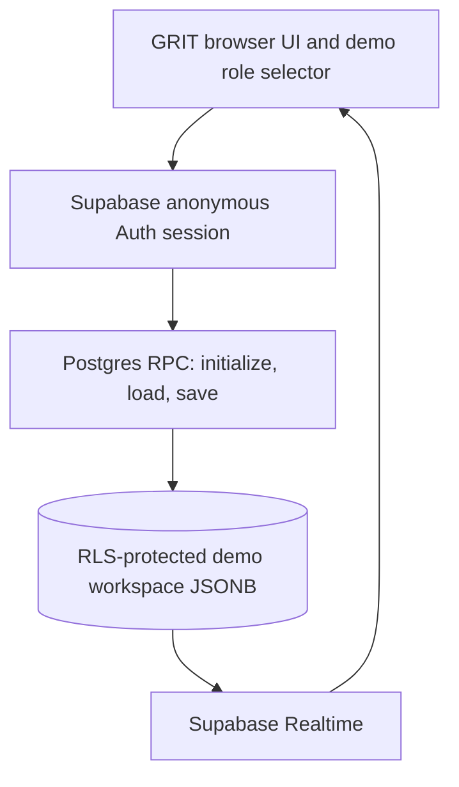

# GRIT Interview Desk B+ — Supabase-backed public demo

Option B+ keeps the GRIT Interview Desk interface and role switcher, replacing browser-only storage with a shared Supabase PostgreSQL workspace and Realtime updates. There is **no visible login screen**. The browser automatically creates a Supabase anonymous Auth session.

> **Demo-only:** Student, Interviewer, Operations and Admin are simulated personas, not verified identities or permissions. Every visitor can operate the same synthetic workspace. Never load real NIAT student data, confidential feedback, real evidence or operational records.

## Features
- Student, Interviewer, Operations and Admin demo views.
- Six synthetic students and two interviewer personas.
- Automatic anonymous Supabase session; no email, password or MFA screen.
- Shared JSONB demo workspace in PostgreSQL.
- RLS-protected table and server-side initialize/load/save RPC functions.
- Optimistic version checking for concurrent updates.
- Duplicate active-slot booking validation.
- Realtime updates across browsers/devices.
- Shared reset for the synthetic demo.
- IST date handling and dynamic sample dates.

## Architecture


The browser uses only the Supabase publishable key. Direct client writes to the workspace table are not granted; changes go through database functions that require an anonymous Auth JWT.

## 1. Supabase setup
1. Create a separate Supabase project named `grit-interview-bplus-demo`. Do not reuse the Option A database.
2. In Authentication → Sign In / Providers, enable Anonymous Sign-Ins.
3. In SQL Editor, run `supabase/migrations/001_public_demo_workspace.sql` once.
4. Run `supabase/verify.sql` and inspect the results.
5. In Vercel, set the two environment variables below.

For any publicly shared demo, configure CAPTCHA/Turnstile and abuse controls before broad distribution. This repo is a controlled evaluator demo until those protections are enabled and tested. Anonymous identity is not a real user identity. The role selector is deliberately not an authorization boundary.

## 2. Environment variables
Set in Vercel (Production, and Preview if used):
- `VITE_SUPABASE_URL`: the B+ Supabase project URL.
- `VITE_SUPABASE_PUBLISHABLE_KEY`: that project's publishable key.

Never put a Supabase secret/service-role key in frontend code or any `VITE_*` variable.

## 3. Local development and build
Requires Node.js 22.12+.

```bash
npm install
cp .env.example .env.local
# Edit .env.local with the B+ project URL and publishable key
npm run dev
npm run build
npm run preview
```

## 4. GitHub
Repository: https://github.com/Venuka-Rao/grit-interview-bplus
Default branch: `main`.

Do not commit `.env.local`, `.env`, database passwords, secret keys or service-role keys. The `.gitignore` excludes local environment files.

## 5. Vercel
1. In Vercel, Add New → Project → import `Venuka-Rao/grit-interview-bplus`.
2. Framework: Vite. Build command: `npm run build`. Output: `dist`.
3. Add `VITE_SUPABASE_URL` and `VITE_SUPABASE_PUBLISHABLE_KEY`.
4. Deploy. Pushes to `main` will trigger deployments when Git integration is enabled.

## 6. Demo walkthrough
1. Open the site in Browser A; choose Student view and select Arjun.
2. Book an open interview slot.
3. Open the same URL in Browser B or an incognito window; choose Interviewer view and select Kavya.
4. Verify the booking appears through Realtime.
5. Check in the student, start the interview and record Pass, Fail or Retake with feedback.
6. Return to Browser A and verify the result updates.
7. Inspect Operations/Admin views and the integrity workflow.

## Known limitations
- This is a public synthetic demo, not a production authorization model. All personas are selectable and can modify demo data.
- One JSONB workspace row is used to preserve the existing prototype UI. It is suitable for a small demo, not the production GRIT data model.
- All visitors share the same state; demo reset affects everyone.
- Optimistic version checks detect conflicts and require retry rather than silent overwrite.
- Anonymous accounts persist in Supabase Auth; configure periodic cleanup.
- No SMTP is needed because the app has no email sign-in flow.
- Do not enter real student data, confidential feedback or malpractice evidence.
